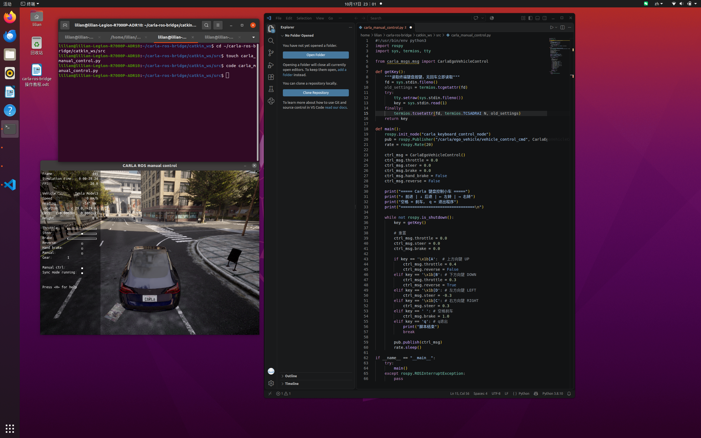
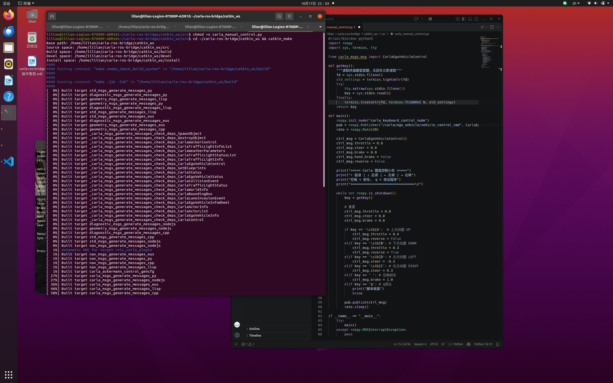

# CARLA + ROS 桥接后，用键盘控制脚本驾驶小车

## 简介

在 Ubuntu 20.04 实体机上完成 CARLA 与 ROS 桥接后，通过 Python 键盘控制节点 `carla_manual_control.py` 发布控制命令驾驶主车。

## 环境要求

* Ubuntu 20.04 实体机（非虚拟机）

* CARLA 0.9.13（安装目录 `/home/lilian/CARLA_0.9.13`）

* ROS Noetic

* carla-ros-bridge（工作区 `~/carla-ros-bridge/catkin_ws`，已编译）

## 配套代码

本教程对应的代码位于仓库 `src/ground/carla_keyboard_control/` 目录：

| 代码文件 | 说明 |
| ---- | ---- |
| `src/ground/carla_keyboard_control/carla_manual_control.py` | 键盘控制脚本，与第四步代码一致 |

## 第一步：运行 CARLA（打开一个终端）

```bash
cd /home/lilian/CARLA_0.9.13

./CarlaUE4.sh
```

等待 CARLA 窗口加载出地图画面（几十秒到几分钟）。

## 第二步：运行 carla-ros-bridge（再打开一个终端）

```bash
cd /home/lilian/carla-ros-bridge/catkin_ws

source ~/carla-ros-bridge/catkin_ws/devel/setup.bash

roslaunch carla_ros_bridge carla_ros_bridge_with_example_ego_vehicle.launch
```

运行成功后，CARLA 窗口会生成主车（Tesla Model3），manual control 面板显示 `ego_vehicle running`。

## 第三步：创建并编辑脚本（再开一个终端）

```bash
# 进入 catkin 工作空间
cd ~/carla-ros-bridge/catkin_ws/src

# 创建脚本文件
touch carla_manual_control.py

# 用 VS Code 打开编辑
code carla_manual_control.py
```



## 第四步：编辑保存

将以下内容粘贴到 `carla_manual_control.py` 并保存（`Ctrl + S`）：

```python
#!/usr/bin/env python3
import rospy
import sys, termios, tty

from carla_msgs.msg import CarlaEgoVehicleControl

def getKey():
    """读取终端键盘按键，无回车立即读取"""
    fd = sys.stdin.fileno()
    old_settings = termios.tcgetattr(fd)
    try:
        tty.setraw(sys.stdin.fileno())
        key = sys.stdin.read(1)
    finally:
        termios.tcsetattr(fd, termios.TCSADRAIN, old_settings)
    return key

def main():
    rospy.init_node("carla_keyboard_control_node")
    pub = rospy.Publisher("/carla/ego_vehicle/vehicle_control_cmd", CarlaEgoVehicleControl, queue_size=10)
    rate = rospy.Rate(20)

    ctrl_msg = CarlaEgoVehicleControl()
    ctrl_msg.throttle = 0.0
    ctrl_msg.steer = 0.0
    ctrl_msg.brake = 0.0
    ctrl_msg.hand_brake = False
    ctrl_msg.reverse = False

    print("===== Carla 键盘控制小车 =====")
    print("↑ 前进 | ↓ 后退 | ← 左转 | → 右转")
    print("空格 = 刹车， q = 退出程序")
    print("================================\n")

    while not rospy.is_shutdown():
        key = getKey()

        # 重置
        ctrl_msg.throttle = 0.0
        ctrl_msg.steer = 0.0
        ctrl_msg.brake = 0.0

        if key == '\x1b[A':  # 上方向键 UP
            ctrl_msg.throttle = 0.4
            ctrl_msg.reverse = False
        elif key == '\x1b[B': # 下方向键 DOWN
            ctrl_msg.throttle = 0.3
            ctrl_msg.reverse = True
        elif key == '\x1b[D': # 左方向键 LEFT
            ctrl_msg.steer = -0.3
        elif key == '\x1b[C': # 右方向键 RIGHT
            ctrl_msg.steer = 0.3
        elif key == ' ': # 空格刹车
            ctrl_msg.brake = 1.0
        elif key == 'q': # q退出
            print("脚本结束")
            break

        pub.publish(ctrl_msg)
        rate.sleep()

if __name__ == "__main__":
    try:
        main()
    except rospy.ROSInterruptException:
        pass
```

## 第五步：编译并运行（再打开一个终端）

```bash
chmod +x carla_manual_control.py

cd ~/carla-ros-bridge/catkin_ws && catkin_make
source devel/setup.bash
rosrun carla_ros_bridge carla_manual_control.py
```



再按 `b` 键启动，运行。

运行演示视频：

<video src="../img/ground/keyboard_control_demo_1.webm" controls></video>

<video src="../img/ground/keyboard_control_demo_2.webm" controls></video>

## 按键说明

| 按键 | 动作 | 发布的值 |
| ---- | ---- | ---- |
| `↑` | 前进 | throttle 0.4 |
| `↓` | 后退 | throttle 0.3，reverse 开启 |
| `←` | 左转 | steer -0.3 |
| `→` | 右转 | steer 0.3 |
| `空格` | 刹车 | brake 1.0 |
| `q` | 退出程序 | 结束节点 |

## 常见报错的处理方法

| 报错信息 | 原因 | 处理方法 |
| ---- | ---- | ---- |
| `rosrun: Couldn't find executable named carla_manual_control.py below carla_ros_bridge` | 脚本没有放在 `carla_ros_bridge` 功能包目录内，`rosrun` 只在包目录内查找可执行文件 | 把脚本移入功能包目录并重新编译：`mv ~/carla-ros-bridge/catkin_ws/src/carla_manual_control.py ~/carla-ros-bridge/catkin_ws/src/carla_ros_bridge/`，再 `chmod +x`、`catkin_make`、`source devel/setup.bash`，最后重新 `rosrun` |
| `chmod: cannot access 'carla_manual_control.py': No such file or directory` | 当前目录不对，脚本不在当前所在目录 | 先 `ls` 确认脚本所在位置，`cd` 到脚本所在目录后再执行 `chmod +x carla_manual_control.py` |
| `roslaunch` 找不到 `carla_ros_bridge` 功能包 | 功能包未编译，或环境未加载 | 在 `~/carla-ros-bridge/catkin_ws` 执行 `catkin_make`，再 `source devel/setup.bash` |
| `ModuleNotFoundError: No module named carla_msgs` | 没有加载桥接编译环境 | 执行 `source ~/carla-ros-bridge/catkin_ws/devel/setup.bash` |
| `SyntaxError: invalid syntax` | 代码粘贴出错，如 `termios.TCSADRAIN` 被写成 `TCSADRAI N`（中间多一个空格） | 检查 `termios.tcsetattr` 那一行，确保写的是 `termios.TCSADRAIN` |
| 黑屏 / 看不到车 | CARLA 地图未加载完，或桥接连不上 CARLA | 等地图加载完再启动 `roslaunch`；确认 `host:=localhost`（同一台机器） |
| 按方向键无反应 | 终端每次只读取 1 字节，方向键是 3 字节转义序列，无法识别 | 改用单字符按键（`w/a/s/d`）替代方向键，或修改 `getKey()` 读取完整转义序列 |
